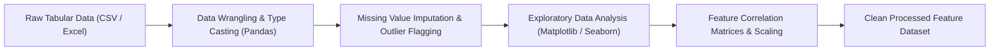

# 🔬 Data Science Academic Laboratories & Exploratory Data Analysis

<p align="center">
  
</p>

<p align="center">
  A practical laboratory repository covering exploratory data analysis (EDA), data wrangling, missing value treatment, and multivariate statistical visualizations completed as part of the Data Science curriculum at Alliance University.
</p>

<p align="center">
  <a href="https://github.com/prakruthidevanga/Data-science">
    
  </a>
</p>

<p align="center">
  
  
  
  
</p>

---

## 📌 Table of Contents

- [📖 Project Overview](#-project-overview)
- [🎯 Objectives](#-objectives)
- [🔬 Laboratory Notebook Contents](#-laboratory-notebook-contents)
- [🏗️ Data Science Workflow](#️-data-science-workflow)
- [🛠️ Technology Stack](#️-technology-stack)
- [📁 Repository Structure](#-repository-structure)
- [⚙️ How to Run & Verify](#️-how-to-run--verify)
- [🔮 Future Enhancements](#-future-enhancements)
- [🤝 Contributing](#-contributing)
- [👩‍💻 Author & Accreditations](#-author--accreditations)

---

## 📖 Project Overview

High-performing machine learning models require rigorous data hygiene, structured feature transformations, and thorough exploratory analysis. Raw tabular datasets frequently contain anomalies, skewed distributions, and collinearity that degrade model accuracy if ignored.

This repository captures foundational Data Science laboratory assignments completed in the Department of Computer Applications at Alliance University. It explores tabular data ingestion, missing value imputation, categorical encoding, feature scaling, and multivariate distribution fitting in Python.

🔬 **Core Mission:** Master the foundational preprocessing and exploratory pipelines essential for reliable data science workflows.

---

## 🎯 Objectives

- 🧹 **Data Wrangling:** Impute missing values, drop duplicates, and normalize incompatible data types using Pandas.
- 📊 **Exploratory Data Analysis:** Compute summary statistics, correlation heatmaps, and pairplots.
- 📐 **Distribution Fitting:** Evaluate feature normality using histograms, KDE plots, and boxplots.
- ⚙️ **Feature Scaling:** Prepare clean feature matrices ready for downstream classification models.

---

## 🔬 Laboratory Notebook Contents

| Notebook Name | Focus Area | Key Data Science Techniques |
| :--- | :--- | :--- |
| `Assignment1 (1).ipynb` | Ingestion & Cleaning | File loading, null checks, duplicate removal, column type casting |
| `Assignment2 Data science.ipynb` | Multivariate Visualizations | Distribution fitting, correlation matrices, boxplots, pairplots |

---

## 🏗️ Data Science Workflow



---

## 🛠️ Technology Stack

<p align="center">
  
</p>

| Component | Library / Framework | Implementation Details |
| :--- | :--- | :--- |
| **Language** | Python 3.9+ | Core data processing runtime |
| **Data Manipulation** | Pandas, NumPy | DataFrame transformations and statistical operations |
| **Visualizations** | Matplotlib, Seaborn | Distribution plots, pairplots, and heatmaps |
| **Interface** | Jupyter Notebook | Interactive exploratory execution environment |

---

## 📁 Repository Structure

```text
Data-science/
├── Assignment1 (1).ipynb          # Data loading, cleaning, and filtering
├── Assignment2 Data science.ipynb # Visual distributions and correlation analysis
└── README.md                      # Project documentation
```

---

## ⚙️ How to Run & Verify

1. Clone this repository:
   ```bash
   git clone https://github.com/prakruthidevanga/Data-science.git
   cd Data-science
   ```
2. Set up environment:
   ```bash
   python -m venv .venv
   .\.venv\Scripts\Activate.ps1
   pip install pandas numpy matplotlib seaborn jupyter
   ```
3. Launch Jupyter:
   ```bash
   jupyter notebook
   ```

---

## 🔮 Future Enhancements

- 🤖 **AutoEDA Integration:** Benchmark ydata-profiling and Sweetviz automated EDA reports.
- 📊 **Interactive Plotly Visuals:** Upgrade static matplotlib plots to zoomable Plotly charts.

---

## 🤝 Contributing

Contributions and exploratory notebook additions are welcomed!

---

## 👩‍💻 Author & Accreditations

**Prakruthi B R**  
*BCA Student specializing in Artificial Intelligence & Machine Learning*  
*Alliance University, Bengaluru (CGPA: 9.60)*  
*GeeksforGeeks Campus Mantri (2026)*

- 💻 **GitHub:** [@prakruthidevanga](https://github.com/prakruthidevanga)
- 🔗 **LinkedIn:** [Prakruthi BR](https://linkedin.com/in/prakruthi-br)
- 🌐 **Portfolio:** [prakruthidevanga.github.io](https://prakruthidevanga.github.io/)
- 📬 **Email:** [prakruthibr2006@gmail.com](mailto:prakruthibr2006@gmail.com)

---

<p align="center">
  <b>🔬 Transforming raw data into structured empirical understanding.</b>
</p>

<p align="center">
  
</p>
